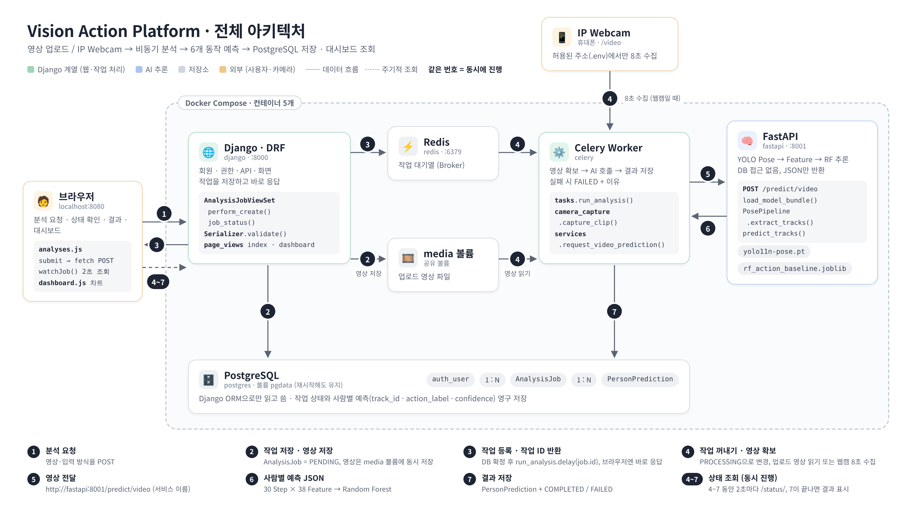
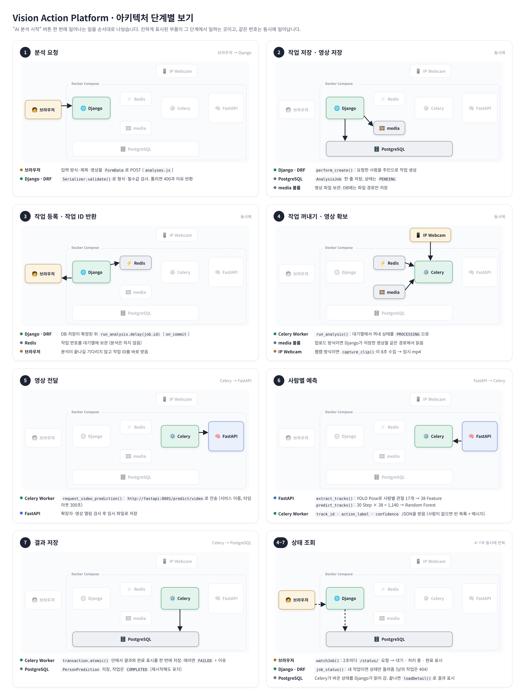
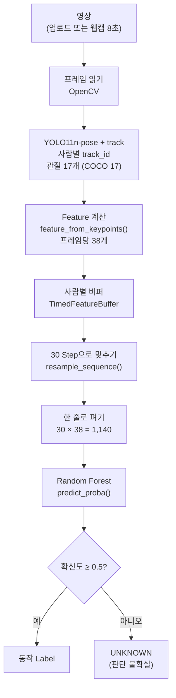
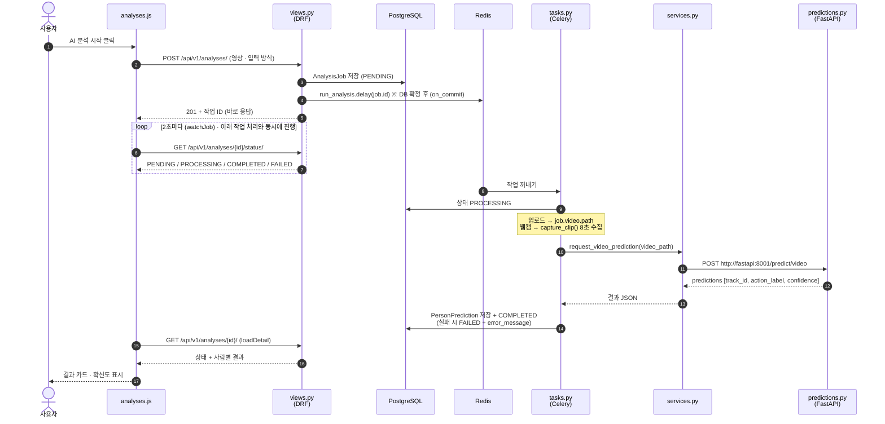
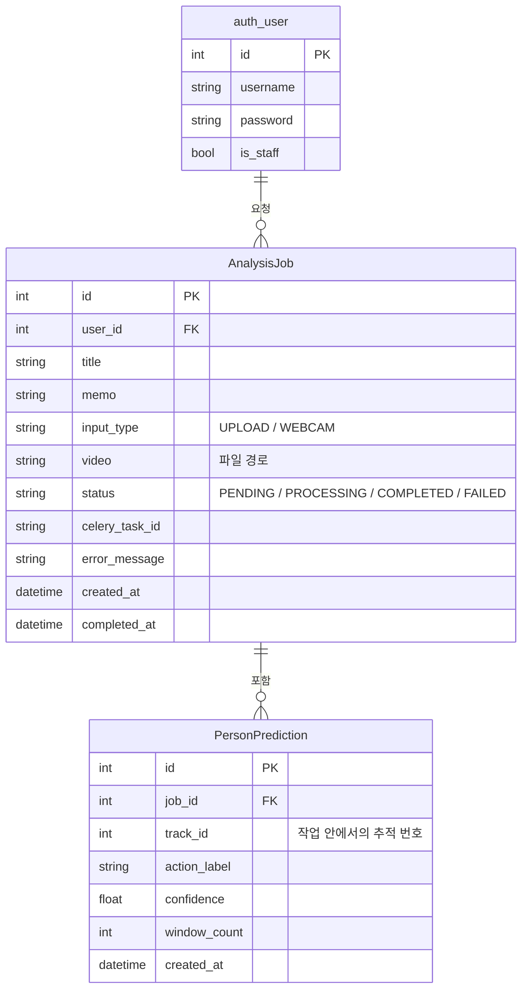

# Vision Action Platform

6일차에 학습한 **Random Forest 동작 인식 모델**을 새로 학습하지 않고 재사용해서, 브라우저에서 AI 분석을 요청하고 결과를 DB에 저장·조회하는 웹 서비스로 만든 프로젝트입니다.

- **입력 2가지:** 영상 업로드(MP4·MOV·AVI), IP Webcam 8초 수집
- **결과:** 영상 속 사람별(`track_id`) 동작 Label과 확신도(Confidence)
- **관리자:** Django Admin + 동작별·상태별 차트 대시보드

| 구분 | 사용 기술 |
|---|---|
| 웹·API | Django 6.1, Django REST Framework |
| 비동기 | Celery 5.7, Redis 7 |
| AI 추론 | FastAPI, Ultralytics YOLO11n-pose, scikit-learn 1.9.1 (Random Forest) |
| DB | PostgreSQL 17 |
| 실행 | Docker Compose (컨테이너 5개) |

---

## 목차

1. [실행 방법](#1-실행-방법)
2. [전체 아키텍처](#2-전체-아키텍처)
3. [AI 추론 파이프라인](#3-ai-추론-파이프라인)
4. [AI 분석 버튼 구현 흐름](#4-ai-분석-버튼-구현-흐름)
5. [DB 설계 (ERD)](#5-db-설계-erd)
6. [사용한 모델과 입력 형식](#6-사용한-모델과-입력-형식)
7. [API](#7-api)
8. [실행 결과와 검증](#8-실행-결과와-검증)
9. [문제 해결 기록](#9-문제-해결-기록)
10. [폴더 구조](#10-폴더-구조)

---

## 1. 실행 방법

### 1-1. 모델 파일 준비 (Git에 포함되지 않음)

용량이 큰 모델 파일은 저장소에 올리지 않았습니다. 6일차 학습 프로젝트에서 아래 파일을 `ai-server/models/`에 복사합니다.

| 원본 위치 (6일차 프로젝트) | 복사할 위치 |
|---|---|
| `artifacts/day06/rf_action_baseline.joblib` | `ai-server/models/` |
| `artifacts/day06/rf_feature_columns.json` | `ai-server/models/` |
| `artifacts/day06/rf_training_info.json` | `ai-server/models/` |
| `yolo11n-pose.pt` | `ai-server/models/` |

### 1-2. 환경변수

```bash
cp .env.example .env
# .env에서 DJANGO_SECRET_KEY, POSTGRES_PASSWORD, IP_WEBCAM_URL 값을 채웁니다.
```

`IP_WEBCAM_URL`은 허용된 카메라 주소 하나만 서버 설정으로 정합니다. 사용자가 임의의 URL을 입력할 수 없습니다.

### 1-3. Docker Compose 실행

```bash
docker compose up -d --build
docker compose ps                     # 5개 컨테이너가 모두 Up인지 확인

docker compose exec django python manage.py migrate
docker compose exec django python manage.py createsuperuser
```

| 화면 | 주소 |
|---|---|
| 사용자 분석 화면 | http://localhost:8080/ |
| 관리자 대시보드 | http://localhost:8080/dashboard/ |
| Django Admin | http://localhost:8080/admin/ |
| FastAPI Swagger (개발용) | http://localhost:8001/docs |

> Django 컨테이너는 내부 8000번이며, 같은 PC의 다른 프로그램과 겹치지 않도록 외부 포트를 8080으로 열었습니다.
> 종료할 때는 `docker compose down`을 사용합니다. `-v`를 붙이면 DB 볼륨이 삭제되므로 사용하지 않습니다.

---

## 2. 전체 아키텍처

**"어떤 구성 요소가 연결되어 있나요?"**



| 서비스 | 역할 | 하지 않는 일 |
|---|---|---|
| **Django · DRF** | 회원·권한, 분석 작업 CRUD, 화면, 대시보드 집계 | AI 모델 학습·추론 |
| **Redis** | Celery 작업 대기열(Broker) | 결과 영구 저장 |
| **Celery Worker** | 영상 확보 → FastAPI 호출 → Django ORM으로 결과 저장 | 화면 렌더링 |
| **FastAPI** | YOLO Pose → Feature → Random Forest 추론, JSON 반환 | **DB 접근** (테이블·ORM 없음) |
| **PostgreSQL** | 사용자·작업·사람별 예측 영구 저장 | — |

**설계 포인트**

- FastAPI는 추론 결과를 **JSON으로 반환만** 하고, 저장은 Celery가 **Django ORM**으로 합니다. AI 서버와 DB 관리를 분리해 FastAPI를 독립적으로 교체·확장할 수 있습니다.
- 컨테이너끼리는 `localhost`가 아니라 **서비스 이름**(`postgres`, `redis`, `fastapi`)으로 통신합니다.
- 업로드 영상은 Django와 Celery가 **공유 볼륨(`media`)** 으로 함께 사용합니다.
- 같은 번호는 동시에 일어나는 일이고, 단계별 상세는 아래 그림과 같습니다.

<details>
<summary>단계별 아키텍처 보기 (1 ~ 7, 상태 조회)</summary>



</details>

---

## 3. AI 추론 파이프라인

**"영상 한 개가 어떻게 동작 예측이 되나요?"**

`rf_action_baseline.joblib`은 **Random Forest 분류기만** 담고 있어서, 영상을 그대로 넣을 수 없습니다. 학습 때와 **똑같은 방식**으로 영상에서 숫자 1,140개를 만들어야 합니다.



| 단계 | 파일 · 함수 | 설명 |
|---|---|---|
| 모델 준비 | `services/model_loader.py` `load_model_bundle()` | 서버 시작 시 1번만 로드. Feature 수(1,140)와 Class 6개가 모델·JSON·학습 정보에서 일치하는지 검사 |
| 사람 추적 | `services/pose_pipeline.py` `PosePipeline.extract_tracks()` | YOLO `track()`으로 프레임마다 같은 사람에게 같은 `track_id` 부여 |
| Feature | `src/multi_person_utils.py` `feature_from_keypoints()` | 8일차 코드 그대로 사용. 관절 좌표 → 정규화 · 각도 → 38개 |
| 예측 | `services/action_inference.py` `predict_tracks()` | 유효 프레임 10개 미만인 사람은 제외. `src/realtime_utils.py` `predict_from_window()` 재사용 |

> 학습 때와 다른 방식으로 Feature를 만들면, 숫자 개수가 같아도 의미가 달라져 예측이 틀립니다. 그래서 기존 `src/` 함수를 **복사해서 그대로** 사용했습니다.

---

## 4. AI 분석 버튼 구현 흐름

**"사용자가 버튼을 한 번 누르면 어떤 파일이 어떤 순서로 동작하나요?"**



| 파일 | 하는 일 |
|---|---|
| `backend/static/js/analyses.js` | 분석 요청, 2초마다 상태 조회, 결과 표시 |
| `backend/analyses/serializers.py` | 입력 검사 (업로드인데 영상 없음 → 400), 상태·결과는 읽기 전용 |
| `backend/analyses/views.py` | 내 작업만 조회, 생성 후 Celery 등록, `/status/` 응답 |
| `backend/analyses/tasks.py` | 영상 확보 → FastAPI 호출 → 결과 저장, 실패 기록 |
| `backend/analyses/services.py` | FastAPI HTTP 요청 · 타임아웃 · 오류 메시지 처리 |
| `backend/analyses/camera_capture.py` | 허용된 IP Webcam에서 정해진 시간만 수집 후 임시 mp4 |
| `ai-server/routers/predictions.py` | 영상 형식 검사 → 추적 → 예측 → JSON |

---

## 5. DB 설계 (ERD)



| 테이블 | 저장하는 것 | 작성 위치 |
|---|---|---|
| `auth_user` | 회원 (Django 기본 User 사용) | Django 기본 제공 |
| `AnalysisJob` | 분석 요청 1건과 진행 상태 | `backend/analyses/models.py` |
| `PersonPrediction` | 영상 속 사람 1명의 예측 | `backend/analyses/models.py` |

- 영상 1개에 두 사람이 나오면 **작업 1건에 예측 2건**이 연결됩니다 (1 : N).
- 영상 파일 자체는 DB에 넣지 않고, `media` 폴더에 저장한 뒤 **경로만** 기록합니다.
- `track_id`는 그 작업 안에서만 쓰는 번호이며, 사람을 영구적으로 구분하는 ID가 아닙니다.

---

## 6. 사용한 모델과 입력 형식

| 항목 | 내용 |
|---|---|
| 분류 모델 | `rf_action_baseline.joblib` (Random Forest, Tree 300개) |
| 입력 차원 | 30 Step × 38 Feature = **1,140** |
| Pose 모델 | `yolo11n-pose.pt` · imgsz 640 · person conf 0.25 (`project.json`, 학습 때와 동일) |
| 판단 불확실 기준 | 확신도 0.5 미만 → `UNKNOWN` |
| 업로드 형식 | MP4 · MOV · AVI |
| IP Webcam | 8초 수집 (`CAPTURE_SECONDS`), 30프레임 미만이면 실패 처리 |

**지원 동작 (6개)**

| ID | Label | 의미 |
|---|---|---|
| A001 | `bend_return` | 허리 굽혔다 펴기 |
| A002 | `leg_raise_lower` | 한쪽 다리 들었다 내리기 |
| A003 | `walk_turn_walk` | 걷다가 방향 바꿔 다시 걷기 |
| A004 | `drink_return` | 음료 마신 뒤 제자리로 |
| A005 | `sit_stand` | 앉았다 일어나기 |
| A006 | `wave` | 손 흔들기 |

> **한계:** 모델은 한 사람(S01)의 영상 6개로 학습했습니다. 새로운 사람·장소·카메라 각도에서는 확신도가 낮아질 수 있으며, 예측 Label을 정답이나 위험 판정으로 간주하지 않습니다. 입력 조건이 다른 두 결과의 확신도를 모델 성능 비교로 해석하지 않습니다.

---

## 7. API

**Django · DRF** (로그인 필요, 내 작업만 조회 가능)

| 기능 | 요청 | 설명 |
|---|---|---|
| 분석 등록 | `POST /api/v1/analyses/` | 작업 생성 후 바로 ID 반환 |
| 내 분석 목록 | `GET /api/v1/analyses/` | 로그인 사용자의 작업만 |
| 분석 상세 | `GET /api/v1/analyses/{id}/` | 상태 + 사람별 결과 |
| 제목·메모 수정 | `PATCH /api/v1/analyses/{id}/` | 상태·결과는 수정 불가 |
| 삭제 | `DELETE /api/v1/analyses/{id}/` | 사람별 예측도 함께 삭제 |
| 상태 조회 | `GET /api/v1/analyses/{id}/status/` | 상태 · 오류 · 완료 여부 |

**FastAPI** (Celery Worker가 호출)

| 요청 | 입력 | 응답 |
|---|---|---|
| `GET /health` | 없음 | 모델 로드 여부, Class, Feature 수 |
| `POST /predict/video` | 영상 파일 | `predictions` (사람별 결과), `message`, `processing_time_sec` |

```json
{
  "person_count": 1,
  "predictions": [
    { "track_id": 1, "action_label": "wave", "raw_label": "wave", "confidence": 0.6367, "valid_frames": 126 }
  ],
  "message": null,
  "processing_time_sec": 1.79
}
```

사람이 없으면 `predictions: []`와 `"영상에서 사람을 찾지 못했습니다"`, 읽을 수 없는 파일이면 400과 이유를 반환합니다. Celery는 두 경우를 구분해 각각 `COMPLETED`(결과 0건)와 `FAILED`로 저장합니다.

---

## 8. 실행 결과와 검증

<!-- 캡처 이미지를 docs/images/에 넣고 아래 경로를 맞춰 주세요 -->

**정상 분석** — `wave.mp4` 업로드 → `wave`, 확신도 0.64


**오류·실패** — FastAPI가 꺼진 상태에서 업로드 → `FAILED`, "AI 서버에 연결할 수 없습니다"


**관리자 대시보드** — 동작별 예측 건수, 작업 상태별 건수


**기능 테스트**

| 테스트 | 상황 | 결과 |
|---|---|---|
| T01 모델 불러오기 | 6일차 모델·JSON | 6개 Class, 1,140 Feature 일치 |
| T02 영상 업로드 | `wave.mp4` | `COMPLETED`, `wave` 0.64 |
| T03 IP Webcam | 8초 수집 | `COMPLETED`, `UNKNOWN` 0.28 (새 환경이라 확신도 낮음) |
| T04 사람별 결과 | 두 사람이 보이는 영상 | 미확인 |
| T05 비동기 처리 | 분석 요청 직후 | 기다리지 않고 작업 ID 반환 |
| T06 영구 저장 | 새로고침 | 작업·결과 유지 |
| T07 CRUD 권한 | 다른 사용자의 작업 조회 | 404 |
| T08 관리자 | 관리자 / 일반 회원 | 대시보드는 관리자만 접근 |
| T09 예외 처리 | FastAPI 중단, 카메라 꺼짐, 영상 없는 요청 | `FAILED` + 이유 저장, 400 |
| T10 Docker | 컨테이너 재시작 | 미확인 |

---

## 9. 문제 해결 기록

| 문제 | 확인한 곳 | 원인 | 해결 |
|---|---|---|---|
| `ContentType doesn't declare an explicit app_label` | `settings.py` | `INSTALLED_APPS`가 두 번 정의되어 Django 기본 앱이 덮어써짐 (이전 프로젝트 설정 복사) | 새 프로젝트로 다시 생성, 기본 User 사용 |
| `cannot import name 'AnalysisJob'` | `analyses/models.py` | 파일이 저장되지 않음 | 저장 후 `makemigrations` |
| 로컬 PostgreSQL·Redis 포트 충돌 | `docker ps` | 다른 프로젝트 컨테이너가 5432·6379 사용 | 개발용 포트를 5434·6381로 분리 |
| Docker에서 Django만 실행 안 됨 | `docker compose up django` | 호스트 8000번 포트 사용 중 | 외부 포트를 8080으로 변경 |
| `failed to resolve host 'postgres'` | Django 컨테이너 로그 | 컨테이너를 따로 켰다 끄며 네트워크가 어긋남 | `docker compose down` 후 다시 `up` |
| Celery 컨테이너가 바로 종료 | `docker compose logs celery` | `No module named 'packaging'` (로컬엔 있지만 requirements에 없음) | `requirements.txt`에 `packaging` 추가 |
| 버튼을 눌러도 상태가 안 바뀜 | Django 로그 `analyses.js 200 0` | JS 파일이 0바이트 (터미널 붙여넣기 실패) | 편집기로 다시 저장, `--force-recreate`로 이미지 반영 |

---

## 10. 폴더 구조

```text
vision_action_platform/
├── backend/                   # Django · DRF · Celery
│   ├── config/                # settings · urls · celery
│   ├── accounts/              # 회원가입 · 로그인
│   ├── analyses/              # models · serializers · views · tasks · services · camera_capture · page_views · admin
│   ├── templates/             # base · 로그인 · 분석 화면 · 대시보드
│   ├── static/                # app.css · analyses.js · dashboard.js
│   ├── requirements.txt
│   └── Dockerfile
├── ai-server/                 # FastAPI 추론 서버
│   ├── main.py
│   ├── routers/predictions.py
│   ├── services/              # model_loader · pose_pipeline · action_inference
│   ├── src/                   # 6~8일차 코드 재사용 (feature · sequence · realtime · multi_person)
│   ├── models/                # 모델 파일 (Git 제외)
│   ├── project.json
│   ├── requirements.txt
│   └── Dockerfile
├── docs/images/               # README 그림
├── compose.yaml
├── .env.example
└── README.md
```
