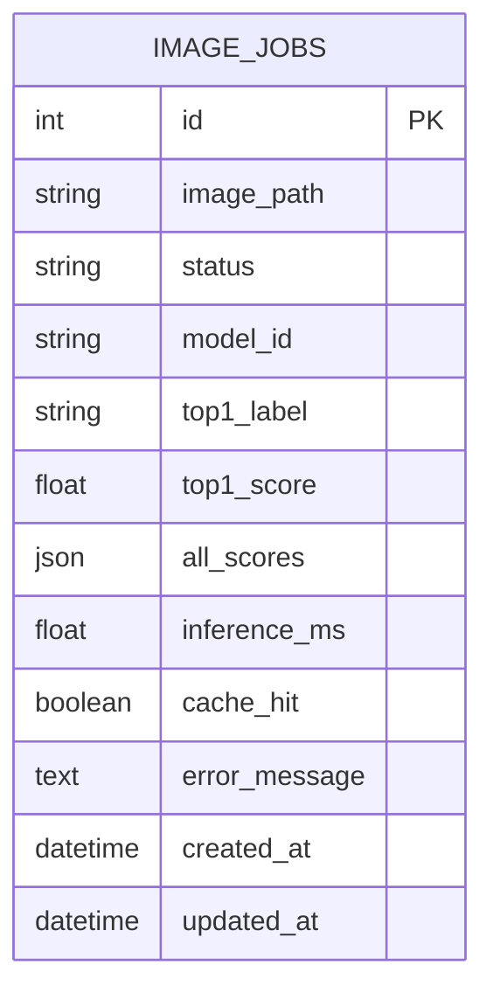

# 04. 데이터베이스 구조 및 작업이력

> **테이블:** `image_jobs` · **PK:** `id` · **DB:** PostgreSQL 17 (Docker `postgres` 컨테이너)
> **저장 대상:** 비동기 추론 작업의 상태와 결과. 동기 요청은 기록하지 않는다.

## 1. ERD



테이블이 하나뿐이므로 FK·관계 테이블은 없다.

## 2. 테이블 정의 (제공 코드 `ai/models.py` 기준)

| 컬럼              | DB 자료형       | Nullable / 기본    | 실제 값 예시                                           | 사용 이유                         |
| --------------- | ------------ | ---------------- | ------------------------------------------------- | ----------------------------- |
| `id`            | INTEGER      | PK               | 6                                                 | 고유 작업번호 = API의 `job_id`       |
| `image_path`    | VARCHAR(150) | 필수               | `08f575905c7f46cf83196761356f6234.bin`            | `media/jobs/`의 이미지 파일명 (uuid) |
| `status`        | VARCHAR(20)  | 기본 `queued`, 인덱스 | `done`                                            | 처리 상태                         |
| `model_id`      | VARCHAR(255) | 기본 빈 문자열         | `artifacts/beans_resnet18`                        | 어떤 모델로 추론했는지 식별               |
| `top1_label`    | VARCHAR(200) | NULL 허용          | `healthy`                                         | 최종 분류 라벨                      |
| `top1_score`    | FLOAT        | NULL 허용          | 0.6759311556816101                                | 최상위 클래스 점수                    |
| `all_scores`    | JSON         | NULL 허용          | `[{"label": "healthy", "score": 0.6759...}, ...]` | 3클래스 전체 점수                    |
| `inference_ms`  | FLOAT        | NULL 허용          | 18.88 / NULL                                      | 실제 모델 추론 시간 (캐시 HIT면 NULL)    |
| `cache_hit`     | BOOLEAN      | NULL 허용          | true                                              | Redis 캐시 재사용 여부               |
| `error_message` | TEXT         | NULL 허용          | NULL                                              | 실패 원인 (최대 1,500자)             |
| `created_at`    | TIMESTAMPTZ  | 기본 UTC 현재시각      | 2026-11-04 15:01:47.361 +0900                     | 접수 시점                         |
| `updated_at`    | TIMESTAMPTZ  | 기본·갱신 시 UTC 현재시각 | 2026-11-04 15:01:47.371 +0900                     | 마지막 상태 변경 시점                  |

- 테이블은 FastAPI 시작 단계(`lifespan` → `init_db()` → `create_all`)에서 없으면 생성된다.
- 운영 환경에서는 `create_all` 대신 Alembic 같은 마이그레이션 도구로 구조 변경을 관리하는 것이 좋다.

## 3. 상태 전이

```text
queued ──(Worker 수신)──> running ──(추론·저장 성공)──> done
                                   └──(예외)──────────> failed + error_message
접수 시 Redis 브로커 연결 실패 ─────────────────────────> failed + 503 응답
```

| 단계 | 기록 주체 | 코드 |
|---|---|---|
| `queued` 생성 | FastAPI | `router_async.enqueue_classify()` |
| `running` | Worker | `tasks.classify_job()` 시작 |
| `done` + 결과 | Worker | `tasks.classify_job()` 성공 |
| `failed` + 원인 | Worker / FastAPI | 예외 처리, 큐 등록 실패 |

빠른 작업이라 `running`을 직접 관찰하지는 못했으며, 정상 완료는 최종 `done`, DB 행, Worker 로그로 판단했다.

## 4. SQL 조회

DBeaver(Host `127.0.0.1`, Port `5432`)에서 실행했다.

```sql
SELECT id, status, image_path, model_id, top1_label, top1_score,
       inference_ms, cache_hit, created_at, updated_at
FROM image_jobs
ORDER BY id DESC
LIMIT 10;
```

## 5. 조회 결과 (실제, 2026-11-04 16:19 시점 job 1~6)

원본: [`data/image_jobs_rows.csv`](data/image_jobs_rows.csv)

| id | status | top1_label | top1_score | inference_ms | cache_hit | 처리시간 (updated − created) | 판정 |
|---:|---|---|---:|---:|---|---:|---|
| 1 | done | bean_rust | 0.7002 | 2148.14 | false | 2,230ms | Worker 첫 추론 (모델 로딩 포함) |
| 2 | done | bean_rust | 0.6839 | 18.88 | false | 33ms | 완료. 입력 `angular_leaf_spot_test.21.jpg` → **오분류** |
| 3 | done | healthy | 0.9727 | 18.06 | false | 30ms | 추론 완료 |
| 4 | done | healthy | 0.9727 | NULL | true | 12ms | job 3과 같은 이미지 → 캐시 재사용 |
| 5 | done | healthy | 0.9459 | 18.57 | false | 32ms | 추론 완료 |
| 6 | done | healthy | 0.6759 | NULL | true | 10ms | 동기 요청이 저장한 캐시를 재사용 |

- 6행 모두 `done`, `error_message`는 모두 NULL. **`failed` 행은 미발생.**
- 캐시 MISS의 추론은 18.06~18.88ms(웜 상태), HIT는 `inference_ms` NULL이며 DB 기준 처리시간도 10~12ms로 짧다.
- 이후 성능 측정 스크립트로 job 8~18이 추가되었다 (모두 `healthy_test.40.jpg`, 상세 → [산출물 6](06_성능비교_보고서.md)).

## 6. 저장 방식

| 데이터 | 저장 위치 | 이유 |
|---|---|---|
| 이미지 원본 | `media/jobs/<uuid>.bin` (WSL 폴더, web·worker 볼륨 공유) | DB를 가볍게 유지. 사용자 파일명·확장자를 신뢰하지 않아 충돌·경로 조작 방지 |
| 작업 상태·결과 | PostgreSQL `image_jobs` | 번호(`job_id`)로 나중에 조회해야 하므로 영구 저장 |
| 동기 결과 | 저장 안 함 (HTTP 응답 + Redis 캐시 600초) | 응답에 결과가 바로 들어가므로 별도 기록 불필요 |
| 큐 메시지 | Redis DB 2 | `job_id`만 전달 |

## 7. 증빙

| 파일 | 내용 |
|---|---|
| `evidence/db_schema.png` | DBeaver `image_jobs` 컬럼 구조 |
| `evidence/db_rows.png` | 위 SQL 조회 결과 |
