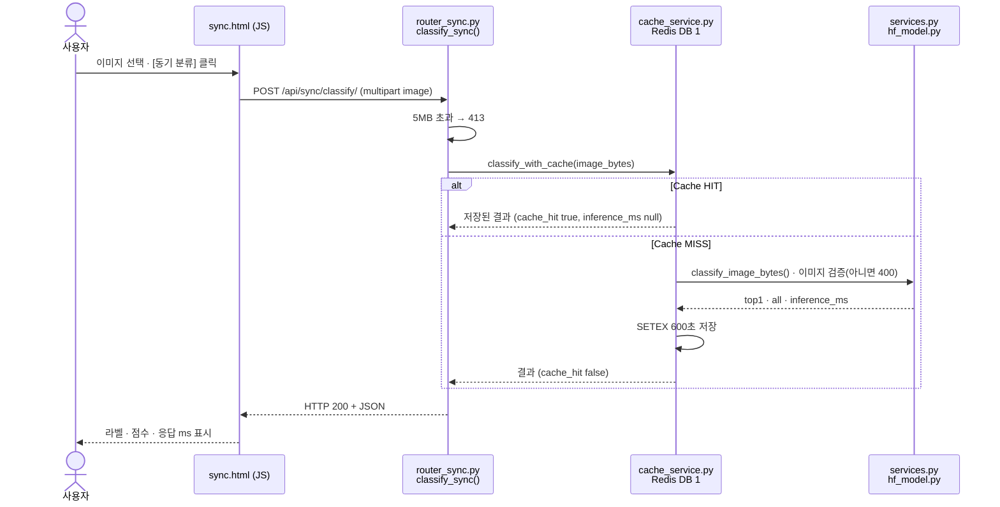
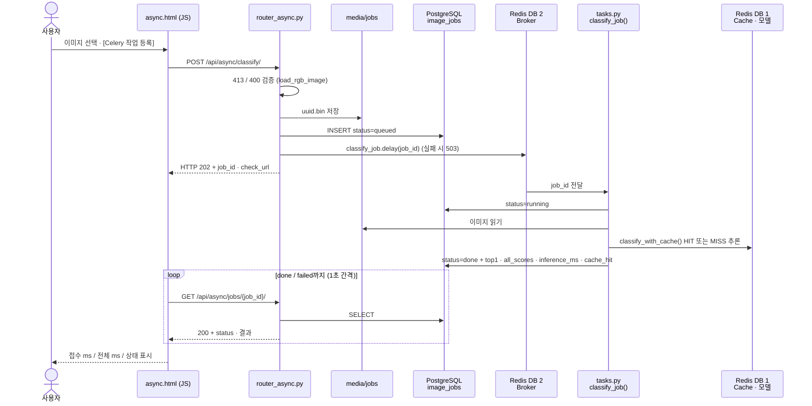

# 05. AI 분석 버튼 처리 흐름

> 사용자가 화면에서 버튼을 누른 뒤 실행되는 파일·함수·데이터 흐름.

## A. 동기 버튼 — `/vision/sync/` [동기 분류]

## B. 비동기 버튼 — `/vision/async/` [Celery 작업 등록]

## C. 코드 연결표

| 단계 | 파일 | 핵심 함수·처리 | 반환 / 다음 단계 |
|---|---|---|---|
| 동기 1 | `templates/sync.html` | `fetch('/api/sync/classify/')` | POST 요청 |
| 동기 2 | `ai/router_sync.py` | `classify_sync()` — 5MB 초과 시 413 | `classify_with_cache()` |
| 동기 3 | `ai/cache_service.py` | `cache_key()` → Redis GET | HIT: 저장 결과 반환 / MISS: 다음 단계 |
| 동기 4 | `ai/services.py` · `ai/hf_model.py` | `load_rgb_image()`(아니면 400) → 모델 추론 | `top1`, `all`, `inference_ms` → Redis SETEX 600초 |
| 동기 5 | `ai/router_sync.py` | 결과 반환 | HTTP 200 |
| 비동기 1 | `templates/async.html` | `fetch('/api/async/classify/')` | POST 요청 |
| 비동기 2 | `ai/router_async.py` | `enqueue_classify()` — 검증, `uuid.bin` 저장, `ImageJob(queued)` | `classify_job.delay(job_id)` → HTTP 202 |
| 비동기 3 | `ai/tasks.py` (Worker) | `classify_job(job_id)` — `running` → `classify_with_cache()` | DB `done` / `failed` |
| 비동기 4 | `templates/async.html` | 1초 간격 `fetch(check_url)` (최대 60회) | 상태 표시 |
| 비동기 5 | `ai/router_async.py` | `get_job(job_id)` — DB 조회, 없으면 404 | 상태·결과 JSON |

## D. 실제 실행 확인

| 경로  | 입력                                      | 결과                                                           | 화면 표시                               |
| --- | --------------------------------------- | ------------------------------------------------------------ | ----------------------------------- |
| 동기  | `healthy_test.40.jpg`                   | 200, healthy 0.6759, `cache_hit false`, `inference_ms 21.71` | HTTP 200 / 응답까지 101ms               |
| 비동기 | `angular_leaf_spot_test.21.jpg` (job 2) | 202 → `done`, bean_rust 0.6839 (오분류), `inference_ms 18.88`   | 접수 22ms / 전체 1036ms / 상태 done       |
| 비동기 | `healthy_test.40.jpg` (job 6)           | 202 → `done`, `cache_hit true`                               | curl로 확인 (`evidence/cache_hit.png`) |

- 화면의 "전체 ms"는 1초 간격 폴링 때문에 실제 처리 완료보다 늦게 표시된다(job 2: DB 기준 처리 33ms, 화면 1036ms).
- 측정 스크립트(0.05초 간격)로 잰 비동기 최종 확인 시간은 [산출물 6](06_성능비교_보고서.md)에 기록했다.

## E. 비교 결론

- **동기:** HTTP 응답을 받을 때 추론 결과가 함께 온다. 응답이 올 때까지 기다린다.
- **비동기:** HTTP 202로 접수만 받고, `job_id`로 따로 조회해야 결과를 받는다. 기다리는 동안 다른 일을 할 수 있다.
- **분류를 수행하는 모델과 캐시는 동일**하다(`classify_with_cache()` 공유). 그래서 동기가 저장한 캐시를 비동기 Worker가 재사용했다(job 6).

## F. 증빙

| 파일 | 내용 |
|---|---|
| `evidence/ui_sync.png` | 동기 화면 결과 |
| `evidence/ui_async_done.png` | 비동기 화면 done |
| `evidence/celery_log.png` | Worker 작업 수신·완료 로그 |
